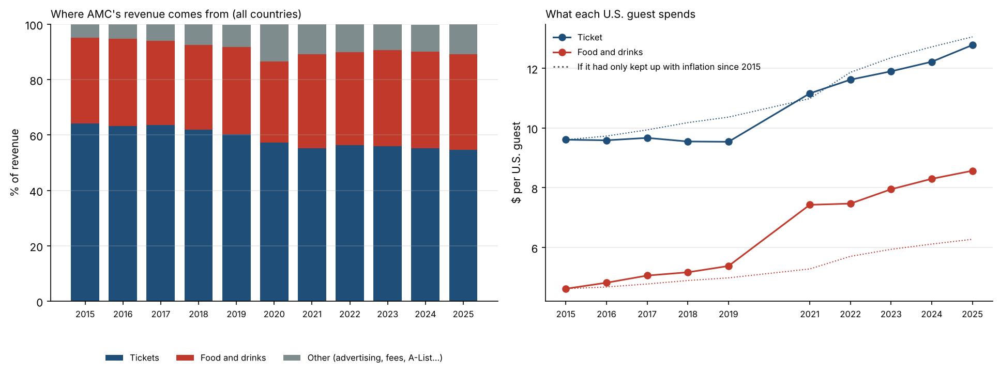
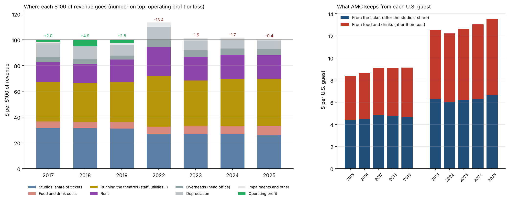
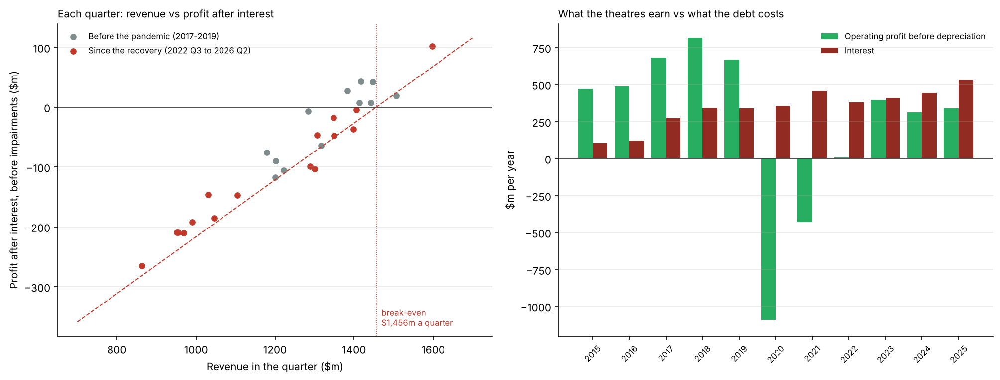
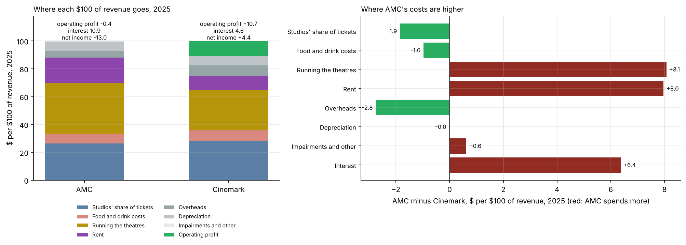

# How AMC Makes Money

**What does each AMC guest bring in, where does that money go, and how many guests does AMC need to make a profit?**

The third project in a series on AMC:
1. [AMC attendance forecast and subscription model](https://github.com/julixlyz08/amc-attendance-forecast-subscription): how many people will go to AMC theatres.
2. [AMC stock vs attendance](https://github.com/julixlyz08/amc-stock-vs-attendance): the stock does not move with attendance; issuing new shares explains the price collapse.
3. **This project**: why AMC needed to issue all those shares. It follows the money from the ticket counter to the bottom line, using every number AMC and Cinemark tag in their SEC filings from 2015 to mid-2026.

> Independent project using public SEC filings. Not affiliated with or endorsed by AMC Entertainment or Cinemark. Not investment advice.

## Summary of findings

**Short answer: AMC's theatres roughly break even, and the debt turns that into large losses.** Guests spend more than ever, mostly on snacks, but AMC has fewer guests than before the pandemic, carries the same fixed costs, and pays more interest each year than its theatres earn before depreciation.

**Where the money comes from (questions 1 and 2)**
1. **Snacks have taken over from tickets as the growth engine.** Tickets fell from 64% of revenue in 2015 to 55% in 2025; food and drinks rose from 31% to 35%, and other revenue (advertising, fees, the A-List subscription) from 5% to 11%.
2. **Ticket prices only kept up with inflation; snack spending beat it.** From 2015 to 2025, the average U.S. ticket rose from $9.61 to $12.78 (+33%, about the same as prices in general, +36%). Food and drink spend per guest rose from $4.62 to $8.57 (+85%, or **+36% after inflation**). U.S. attendance fell 21% over the same years (197 to 156 million).

**Where the money goes (question 3)**

3. **Of each ticket dollar, AMC keeps about 52 cents** (the studios take the rest); **of each food and drink dollar, about 80 cents.** In 2025 a U.S. guest left AMC $6.64 from the ticket and $6.89 from snacks: snacks now bring in slightly more than the film itself.
4. **Of every $100 of revenue in 2025:** $26 to studios, $7 for the food, **$37 to run the theatres** (staff, utilities, upkeep; $31 in 2019), **$18 rent**, $5 head office, $7 depreciation, $1 impairments. That leaves an operating loss of 40 cents, before **$11 of interest**. Net result: a loss of $13 per $100.

**What attendance does to profit (questions 4 and 5)**

5. **Revenue moves one for one with attendance** (1.02% more U.S. ticket and snack revenue per 1% more guests, 14 quarters since 2023), **but costs mostly do not.** About 52.5 cents of each revenue dollar is a cost that rises with business; the rest of the costs, **about $1.9bn a year, are fixed**: the same as before the pandemic, on about 12% less revenue. A straight line fits the last 16 quarters closely (R² of 0.98).
6. **Break-even, from the last four quarters' revenue of $5.23bn** (2025 Q3 to 2026 Q2):
   - to pay its running costs: $4.0bn of revenue, already passed comfortably (24% below current revenue);
   - to make an operating profit: $4.65bn, passed (11% below);
   - **to cover interest as well: $5.8bn, 11% more than today, or about 184 million U.S. guests a year at today's spend** (165 million over the last four quarters; 250 million in 2019).

**The debt (question 6)**

7. **Interest has grown five-fold since 2015** ($106m to $530m a year), while what the theatres earn before depreciation halved from 2019 ($670m) to 2025 ($340m). **Since 2023, interest has been larger than everything the theatres earn before depreciation**: $1.56 of interest for each $1 earned in 2025. That gap is what the share sales of the stock project paid for.

**Compared with Cinemark (question 7)**

8. **Cinemark earned an operating profit of $10.70 per $100 of revenue in 2025; AMC lost $0.40.** The gap is in **rent ($18.30 vs $10.30)** and **running the theatres ($36.80 vs $28.80)**, and then **interest ($10.90 vs $4.60)**. AMC's film costs and head-office costs per $100 are lower (Cinemark's film line also includes its advertising). Cinemark made $4.40 of net income per $100; AMC lost $13.






## Questions

| # | Question | Script |
|---|---|---|
| 1 | **Where does the revenue come from?** Tickets, food and drinks, and other (advertising, fees, A-List). How has the mix changed since 2015? | `01_revenue_per_guest.py` |
| 2 | **What does each guest bring in?** Spend per U.S. guest on tickets and on food and drinks, against inflation. | `01_revenue_per_guest.py` |
| 3 | **Where does the money go?** Each $100 of revenue split into studios' share, food costs, theatre running costs, rent, head office, depreciation, impairments, interest and profit. | `02_where_money_goes.py` |
| 4 | **How closely does revenue follow attendance?** | `03_breakeven_and_debt.py` |
| 5 | **How much revenue, and how many guests, does AMC need to break even?** At three levels: running costs, operating profit, and after interest. | `03_breakeven_and_debt.py` |
| 6 | **How much does the debt cost?** Interest against what the theatres earn before depreciation. | `03_breakeven_and_debt.py` |
| 7 | **How does AMC compare with Cinemark?** | `04_cinemark.py` |

## Data

| Source | What | Where |
|---|---|---|
| AMC quarterly reports, via the attendance project | U.S. attendance, ticket and food and beverage revenue: 2015 Q1 to 2026 Q2 | `data/amc_quarterly.csv` |
| SEC EDGAR XBRL API (summary) | Every standard-tagged value in AMC's and Cinemark's 10-Q and 10-K filings | `data/amc_facts.csv`, `data/cnk_facts.csv` (`fetch_financials.py`) |
| Each 10-Q and 10-K's full XBRL file | Every value, including company-specific lines (e.g. film exhibition costs) and values split by product or segment, which the summary leaves out | `data/amc_xbrl.csv.gz`, `data/cnk_xbrl.csv.gz` (`fetch_filing_xbrl.py`) |
| Built from the above | One income statement per company, by quarter, in US$ millions | `data/amc_income_statement.csv`, `data/cnk_income_statement.csv` (`build_financials.py`) |
| Bureau of Labor Statistics | Consumer price index (CPI-U), monthly 2016 to 2026; 2015 annual average | `data/cpi_monthly.csv`, `common.py` |

Data notes:
- **Checks.** For every quarter of both companies, the revenue lines add up to total revenue, and revenue minus costs equals reported operating income, to within $0.1m. Annual totals match the companies' reported results, e.g. AMC's revenue of $5.47bn and net loss of $149m in 2019.
- **Tags change over time.** AMC reported ticket revenue as `AdmissionsRevenue` until 2017 and as revenue split by product from 2018; each line has an ordered list of tags, and `data/amc_tags_used.csv` records which tag supplied each line in each year.
- **Fourth quarters** are derived as full year (10-K) minus the first nine months (Q3 10-Q).
- **Cinemark's 2023 filings** combine the parent company and a subsidiary; a few lines appear twice with opposite signs. The parent company's values are used.
- **Attendance is U.S. only.** Neither company tags attendance in its data files, so per-guest figures use AMC's U.S. attendance and U.S. revenue from the attendance project. "What AMC keeps per U.S. guest" combines U.S. spend with company-wide cost rates (U.S. cost rates are only reported from 2024).
- **AMC's size changed in late 2016 and early 2017** with the Carmike, Odeon/UCI and Nordic acquisitions. Before that, AMC was a smaller, almost entirely U.S. company, so comparisons of totals start in 2017.
- **Rent before and after 2019 is not like for like.** A new lease accounting standard took effect in 2019, which is why AMC's rent line jumps that year.
- **Interest** includes AMC's interest on corporate borrowings, on finance leases, and (from 2018) non-cash interest on its advertising agreement with NCM.
- **Cinemark's lines are defined slightly differently:** its film costs include advertising, and staff costs are reported separately (they are added to "running the theatres" here).

## Method: break-even

Costs are split into a part that rises with revenue and a fixed part with a straight-line fit of each quarter's cash operating costs (all costs except depreciation and impairments) against revenue. Two periods are fitted: 2017 to 2019, and 2022 Q3 to 2026 Q2. Then:

- **Running-cost break-even** = fixed costs / (1 - variable share)
- **Operating break-even** adds depreciation
- **After-interest break-even** adds interest, at the level of the last four quarters (interest has risen as debt was refinanced)

Converting revenue into guests assumes spend per guest and the U.S./International mix stay as they are.

## Limitations

- **The break-even is a straight-line approximation.** Some "fixed" costs can be cut (theatre closures, staffing), and some rise with time regardless of attendance (wages, rent escalators). The fit is close within the range seen since 2022, but less reliable far outside it.
- **Taxes, cash flow and capital spending are not covered.** Depreciation is a non-cash cost, but theatres need regular reinvestment, and some interest is non-cash.
- **Per-guest figures are U.S. only**, because international attendance is not tagged in the filings.
- **Cinemark's lines are not defined identically to AMC's** (see data notes); the comparison is of broad shares, not exact line items.

## How to run

```
pip install pandas numpy matplotlib requests
python fetch_financials.py      # set your name and email in SEC_USER_AGENT first
python fetch_filing_xbrl.py     # same; reads every 10-Q and 10-K, about 5 to 10 minutes
python build_financials.py      # income statements by quarter, with checks
python 01_revenue_per_guest.py  # questions 1 and 2
python 02_where_money_goes.py   # question 3
python 03_breakeven_and_debt.py # questions 4 to 6
python 04_cinemark.py           # question 7
```

## Repository layout

```
fetch_financials.py, fetch_filing_xbrl.py   download the SEC data
build_financials.py                         one income statement per company, by quarter
common.py                                   shared loaders and chart helpers
01_ ... 04_*.py                             one script per group of questions
data/                                       inputs and built tables
charts/, results/                           created by the scripts
```
